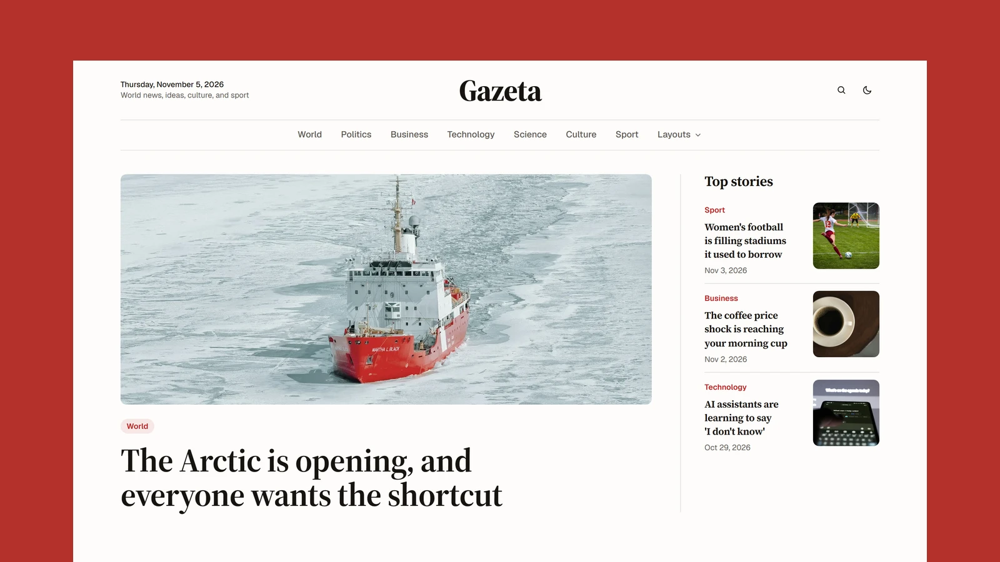

# Gazeta - Astro Newspaper Theme

[](https://gazeta.xocoweb.workers.dev/)

[](https://astro.build/)
[](https://tailwindcss.com/)
[](https://www.typescriptlang.org/)
[](./LICENSE)

**Live preview:** https://gazeta.xocoweb.workers.dev/

Gazeta is a modern Astro newspaper and magazine theme for publishers covering world news, politics, business, science, culture, and sport. It pairs a readable serif with a clean sans interface, warm paper tones, and rounded photography, and stays fully static.

## Features

- Front page with a lead story, top stories, section blocks, a dark sport band, and a latest-stories grid
- Masthead that shows the reader's current date, with section links and pill navigation on mobile
- Source Serif 4 for headlines and article copy, Geist for the interface, both self-hosted
- Article pages with a centered headline, byline avatar, drop cap, pull quotes, and in-article photos with captions
- Four story layouts (standard, banner, cover, and immersive), previewed from a Layouts menu in the header
- Photo lightbox for article covers and in-article photos
- Share sheet with brand-colored targets and copy link, and the device's native share sheet on phones
- Author photos on bylines, author cards, and an about-page masthead
- Pill tags, category pills, and paginated archives for every section, tag, and all news
- Search palette opened with Ctrl/Cmd + K or /, ranked results, and a search page that works without JavaScript
- Light and dark modes with a remembered choice
- 28 demo stories across seven sections with Unsplash and Pexels photography
- Typed content collections with validated frontmatter for titles, excerpts, sections, dates, authors, tags, covers, credits, trending, and drafts
- Responsive Astro images for every cover and in-article photo
- Canonical URLs, sitemap, RSS, Open Graph, Twitter/X cards, and JSON-LD
- Provider-neutral newsletter and contact forms, an about page with a masthead, and a privacy starter page
- Accessible skip link, landmarks, labels, keyboard-friendly dialogs, and visible focus states
- Restrained motion that respects `prefers-reduced-motion`
- Tailwind CSS 4 tokens with no external font, script, or asset requests

## Tech Stack

- Astro 7
- Tailwind CSS 4 via the Vite plugin
- Vite 8
- TypeScript
- Astro content collections
- `@astrojs/sitemap`
- `@astrojs/markdown-remark` with `rehype-slug` for heading anchors
- Sharp for image processing

## Requirements

- Node.js `22.12.0` or newer
- npm

## Getting Started

```bash
npm install
npm run dev
```

Build for production:

```bash
npm run build
```

Preview the production build locally:

```bash
npm run preview
```

Run the release checks:

```bash
npm run release:check
```

## Customization

See [CUSTOMIZATION.md](./CUSTOMIZATION.md) for site settings, sections, the newsletter, frontmatter, story layouts, the contact form, author photos, sharing, search, images, icons, pages, fonts, and theme tokens.

Set `siteConfig.siteUrl` in [src/config/site.ts](./src/config/site.ts) to your own domain before building. Canonical URLs, RSS, `robots.txt`, the sitemap, Open Graph tags, and JSON-LD are all derived from it.

The build is a plain static `dist/` directory, so any static host will serve it. The bundled [wrangler.jsonc](./wrangler.jsonc) is only there because the live preview runs on Cloudflare Workers; delete it if you deploy anywhere else.

## Content

Posts live in [src/content/posts](./src/content/posts). Each post is a folder with an `index.md` and a `cover.jpg`, plus any in-article photos. Frontmatter is validated by the schema in [src/content.config.ts](./src/content.config.ts).

The demo covers and in-article photos come from [Unsplash](https://unsplash.com/) and [Pexels](https://www.pexels.com/) under their free licenses; each post credits its photographer, and the article page prints that credit under the photograph. Replace them with your own media before publishing, and check the rights on anything you keep.

## Support

See [SUPPORT.md](./SUPPORT.md) for what is included with a license.

## License

Commercial license. See [LICENSE](./LICENSE) for complete terms.

## Credits

- [Source Serif 4](https://github.com/adobe-fonts/source-serif) by Adobe, under the SIL Open Font License
- [Geist](https://github.com/vercel/geist-font) by Vercel, under the SIL Open Font License
- [Bootstrap Icons](https://icons.getbootstrap.com/), under the MIT License
- Cover photography from Unsplash and Pexels, credited per post; contributor portraits from Pexels
