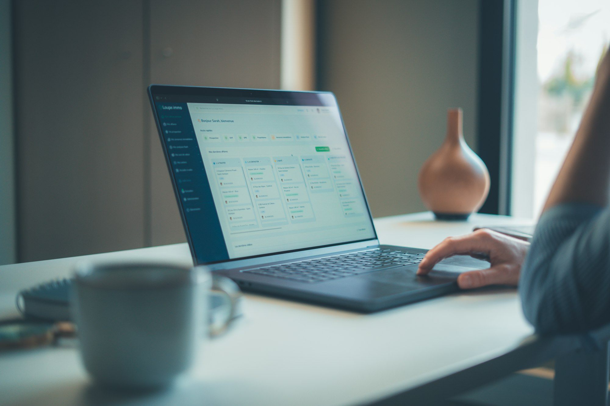

The question was ordinary: which form does a small business owner need to file when hiring a first employee? The assistant on Nadia's laptop gave a tidy, confident answer, complete with a form number and a deadline. The form number was wrong. She found out three weeks later, when an accountant gently pointed it out.

Stories like that have shaped how millions of people use AI tools. The software sounds certain whether it is right or wrong, so users learn either to double-check everything or to stop trusting it altogether. Now the companies building these assistants are trying a different approach: teaching them to hedge, to ask a follow-up question, and sometimes simply to say they don't know.

## Confidence was the default setting

Large language models are trained to produce fluent, plausible text. Fluency and accuracy are not the same thing, and early systems had little incentive to mark the difference. An answer that sounded authoritative was rewarded more often than one that admitted a gap.

Developers have been working to change that balance. Newer assistants are being tuned to recognize when a question falls outside what they can reliably answer, when sources disagree, or when the right response depends on details the user has not given. Instead of filling the silence, the assistant might say it is unsure, point to where the answer could be checked, or ask a clarifying question first.

_Many workers now route routine questions through an assistant before asking a colleague. Photo: Gabriel Weyand / Unsplash_

## Users notice the difference

It sounds like a step backward, a tool that answers fewer questions. In practice, people who test these systems describe the opposite reaction.

> When it told me it wasn't sure, I actually believed the next thing it said. Before, I had no way of knowing which answers to worry about.

That was a paralegal named Marcus, who uses an assistant daily to draft summaries of long documents. He says a single honest "I'm not certain this applies in your state" saved him more time than a dozen confident paragraphs, because it told him exactly where to look.

Researchers who study human trust in software call this calibration: the goal is not for a tool to be confident or cautious, but for its confidence to match how likely it is to be right. A weather forecast that says 70 percent chance of rain is useful because, over time, it rains about that often.

## Where uncertainty still gets lost

The shift is uneven. Admitting uncertainty can make a product feel less impressive in a quick demo, and there is commercial pressure to keep answers crisp. Some assistants overcorrect, wrapping simple facts in so many caveats that users tune them out.

There is also a design problem. A small phrase like "I might be wrong" can be easy to miss in a long reply. Teams are experimenting with clearer signals:

- Flagging specific sentences that the assistant is less sure about
- Showing where information came from, so users can check it
- Asking one targeted question before answering instead of guessing

For Nadia, the change would have been simple. All she needed was a single line saying the form number should be confirmed. She still uses the assistant every day, she says, but now she asks it how sure it is.
