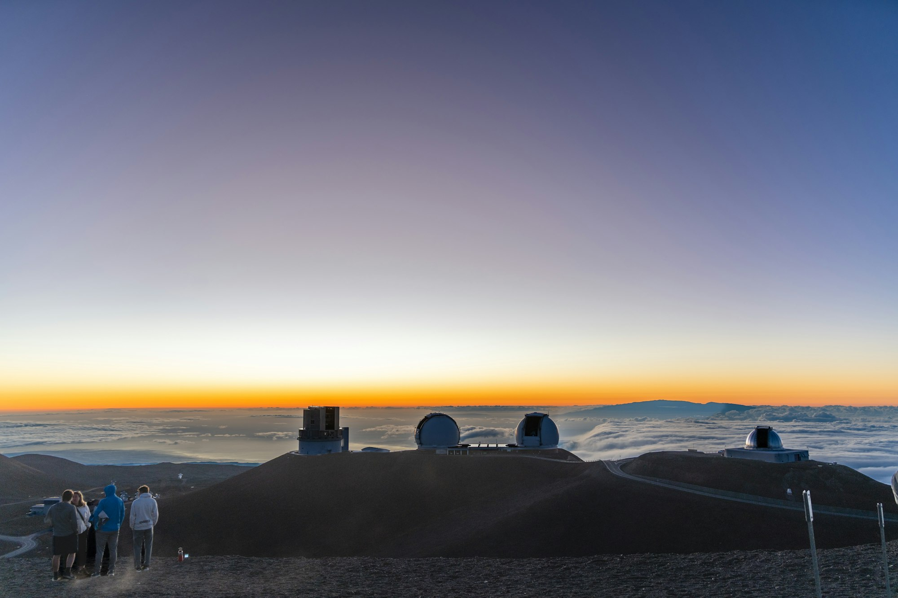

The forecast for one particular planet reads like a postcard from somewhere unpleasant. Iron clouds on the night side. Winds strong enough to circle the globe in a day. A band of haze that thickens at dusk and burns off by noon. Nobody has been there, and nobody ever will, yet the report is built on real measurements taken from the ground and from orbit.

A decade ago, astronomers were pleased simply to confirm that a planet existed around a distant star. Now a growing number of teams are asking a more ordinary question: what is the weather like?

## Reading a sky through a keyhole

The method relies on timing. When a planet passes in front of its star, a thin sliver of starlight shines through the edge of its atmosphere before reaching our telescopes. Different gases absorb different colors, leaving faint fingerprints in the spectrum. Water vapor, carbon dioxide, and sodium each leave a mark.

Weather comes from watching those fingerprints change. By comparing the leading edge of the planet with the trailing edge, researchers can tell whether the morning side is cooler or cloudier than the evening side. By following a planet around its full orbit, they can map how heat spreads from the scorching day side to the dark one.

> "It is like trying to describe a storm by looking at a candle through somebody else's window," said a postdoctoral researcher who spends most of her nights reducing telescope data. "But the candle flickers in a pattern, and the pattern tells you a lot."

## Clouds that rain glass

The results are strange by any earthly standard. Many of the best-studied planets are gas giants orbiting so close to their stars that a year lasts only a few days. One side faces the star permanently, and temperatures there can melt rock.

On those worlds, clouds are not made of water. Models suggest droplets of silicate minerals, close cousins of sand and glass, that condense on the cooler night side and evaporate again when winds carry them back into daylight. Some planets appear to have clear mornings and cloudy evenings; others seem to be wrapped in a uniform haze that hides almost everything beneath it.

_Observatories perched above the clouds, where thin, dry air gives telescopes a clearer view. Photo: Diwei Zhu / Unsplash_

## From snapshots to seasons

What astronomers want next is time. A single observation is a snapshot; a series of them, spread over months, starts to look like a climate record. Teams are now coordinating campaigns that return to the same planet again and again, watching for changes that might signal storms or seasons.

The ambition is not purely about exotic giants. The techniques being refined today will eventually be turned toward smaller, rockier planets in milder orbits, where the question shifts from "what is the weather" to "could anything live in it."

For now, the forecasts remain rough sketches with wide margins of error. But the sketches are getting sharper with every season of observing, and the vocabulary of weather reports, from fog and drizzle to jet streams, has quietly entered the language of planetary science.
