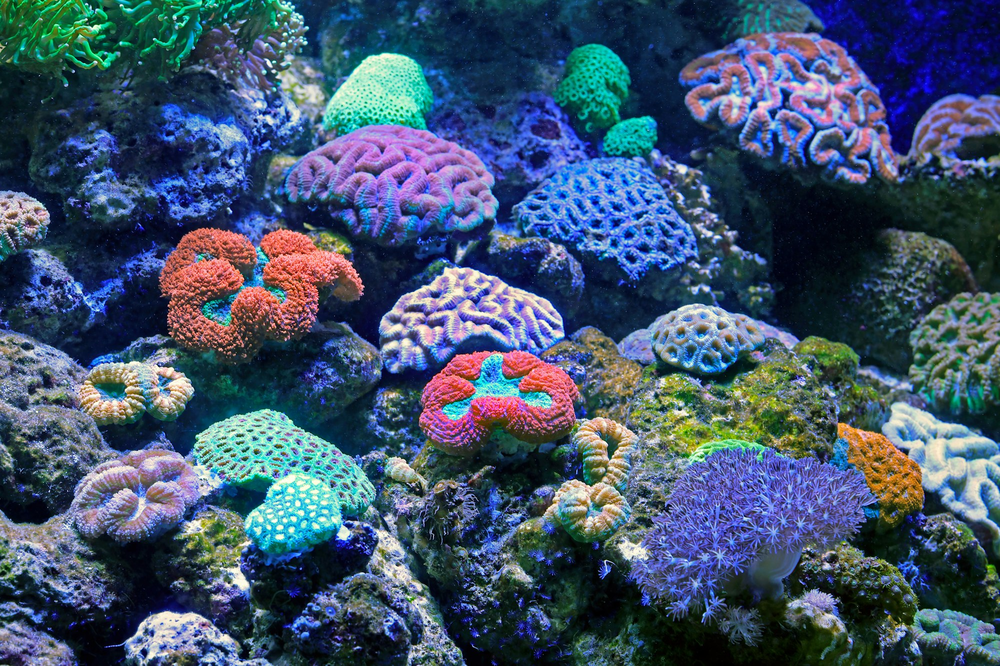

The warehouse sits on an industrial estate between a tire shop and a bakery supplier, hundreds of miles from the nearest reef. Inside, under rows of blue-white lights, dozens of shallow tanks bubble quietly. Each one holds trays of coral fragments no bigger than a thumbnail, glued to small ceramic plugs and labeled with handwritten codes.

Some of these fragments came from wild reefs that survived recent marine heatwaves when most of their neighbors did not. Others were grown from those survivors here, in water kept slightly warmer than usual on purpose. In a few months, many of them will be packed into insulated boxes and flown back to the coast to be planted on damaged reefs.

## Why grow coral indoors

Coral restoration is usually done in the ocean, with fragments hung on underwater frames that look like rows of tiny Christmas trees. Those nurseries work well, but they are exposed to the same storms and heatwaves that damaged the reefs in the first place. When the water gets too warm, the nursery can bleach along with everything around it.

Land-based tanks offer more control. Temperature, light, and water chemistry can be adjusted precisely, which lets researchers test which corals cope best with heat and gently push young colonies to tolerate a little more. A tank can also grow fragments faster, through a technique called micro-fragmenting, in which tiny cuttings heal and spread more quickly than a larger piece would.

_Aquarium-grown corals can be kept under tightly controlled light and temperature. Photo: David Clode / Unsplash_

## The hobbyists who knew how

Much of the know-how for keeping corals alive in tanks did not come from universities. It came from home aquarium keepers, who spent decades figuring out lighting schedules, water flow, and feeding routines through trial and error and online forums.

> For years people thought we were just collectors with expensive hobbies. Now scientists call us asking how we keep certain species from crashing in summer.

That is how one aquarium keeper, who runs a coral-propagation setup in a converted garage, described the shift. He now shares fragments and notes with a regional restoration project and volunteers to help pack shipments.

Collaborations like this have spread. Public aquariums have turned behind-the-scenes rooms into coral nurseries. Some hobby groups maintain "gene banks" of reef species, keeping living backups in case wild populations decline further.

## A bridge, not a cure

The people doing this work are careful about what it can achieve. Restored patches are small compared with the scale of reef loss, and planting corals does little good if the water keeps warming. Fragments raised indoors also need time to adjust to the open ocean, and not all of them survive the move.

What tank nurseries can do, researchers say, is buy time and preserve diversity:

- Keeping heat-tolerant genetic lines alive between bad seasons
- Producing large numbers of fragments for targeted replanting
- Giving scientists a controlled place to study how corals respond to stress

Back at the warehouse, a technician lifts a tray from one of the tanks and holds it up to the light. The fragments have grown a millimeter or two since last month, pale edges creeping over the ceramic plugs. It is slow work, she says, but for the first time in a while, it feels like progress.
