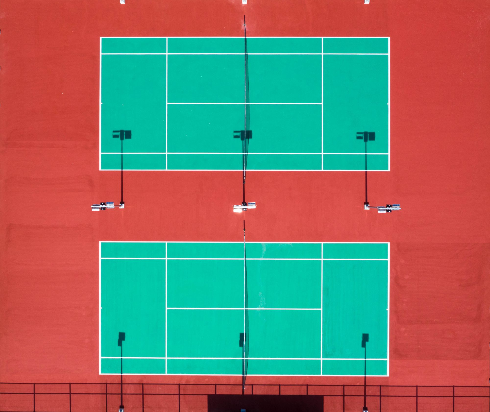

At a public club on a weekday evening, a 16-year-old hits serve after serve into the far court while her coach watches a tablet instead of the ball. A small camera clipped to the fence tracks every shot. After each one, a dot appears on a diagram of the service box, colored by speed. After twenty serves, a pattern emerges that neither of them had noticed: almost every second serve lands in the same narrow strip near the center line.

"That's why they keep attacking it," the coach says, turning the screen toward her. The fix will take weeks. Finding the problem took ten minutes.

## Tools that used to live at the top

Detailed tracking has been part of professional tennis for years, but it relied on expensive multi-camera systems installed at major venues. What has changed is the price and size of the hardware. A single smart camera, a racket sensor, or even a phone app can now log ball speed, spin, placement, and rally length well enough to be useful at club and junior level.

The result is that coaches who once relied entirely on their eyes and memory now have a second opinion. Sometimes it confirms what they already believed. Sometimes it does not.

_Seen from above, a court becomes a grid of zones that tracking software can measure shot by shot. Photo: Aidil Bahaman / Pexels_

## When the numbers argue back

Coaches describe a common experience: discovering that a habit they had been reinforcing for years does not hold up. A favorite drill turns out to produce rallies far longer than real matches ever do. A player who "always" goes cross-court on big points turns out to go down the line more often than anyone thought.

> I've coached for twenty years, and the first month with the camera was humbling. Half the things I was sure about were only half true.

That was one club coach describing his adjustment. He still trusts his instincts, he says, but now he checks them.

Data is also reshaping how practice time is spent. Many matches at club level are decided in the first four shots of a point, and coaches who see that pattern in their own players' numbers tend to rebalance training toward serves, returns, and the shot right after. Long baseline drills do not disappear, but they shrink.

## Keeping the player in the picture

There are limits, and good coaches are wary of them. Numbers can describe what happened without explaining why. A dip in first-serve percentage might be a technical flaw, a tight shoulder, or simple nerves, and a tablet cannot tell the difference.

Younger players also respond differently. Some love the scoreboards and chase personal bests. Others freeze when every shot is measured. Several coaches now keep the screen out of sight during lessons and share a short summary afterward, focusing on one or two things rather than a wall of statistics.

Some of the habits coaches recommend for using data well:

- Pick one measurable goal per session instead of tracking everything
- Compare a player to their own past numbers, not to professionals
- Watch video alongside the data so the "why" is not lost

Back at the club, the teenager is aiming her second serve wide now. The dots on the screen start to spread out. Her coach puts the tablet down and just watches.
