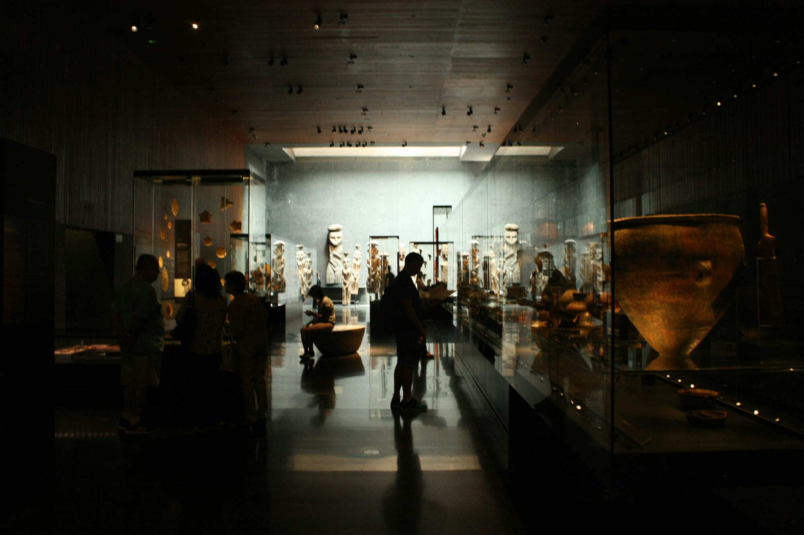

At nine on a Thursday evening, the line outside the museum stretches past the bike racks. Inside, a DJ plays low, unhurried music beneath a skylight, the cloakroom is out of hangers, and a group of friends in their mid-twenties is debating, with real passion, which of three seventeenth-century portraits looks most like their landlord.

Late openings are not new, but they have changed character. What began as an occasional fundraiser has become, at many institutions, a weekly fixture, and the people walking through the doors look very different from the weekday-morning crowd.

## A gallery after dark feels different

Visitors describe the evening museum as calmer and more personal. School groups have gone home. The lighting is softer. Conversation is louder than a library and quieter than a bar, and nobody minds if you sit in front of one painting for twenty minutes.

Museums have leaned into that mood. Some dim the main halls and light only key works. Others scatter cushions on the floor of sculpture courts or open rooftop terraces that are closed during the day. Short talks by curators, often fifteen minutes or less, run on a loop so visitors can drift in and out.

> "In the daytime I feel like I'm supposed to be learning something," said a graphic designer who now visits once a month. "At night I'm just allowed to look."

## The audience they kept missing

For years, surveys at many institutions showed the same gap. Retirees and parents with young children came often. Adults between roughly twenty and forty, busy with work and wary of entry fees, came rarely or not at all.

Evening programs appear to be closing that gap. Staff at several museums say late-night audiences skew noticeably younger, and that many visitors are first-timers or people who had not been since a school trip. A modest ticket price, sometimes bundled with a drink, helps lower the barrier.

_Dim lighting and quiet halls give evening visitors a different way to see a collection. Photo: Camila Credidio / Unsplash_

## Keeping the art safe and the lights on

The model brings its own challenges. Drinks and fragile objects are an uneasy mix, so most museums keep bars in lobbies or courtyards and post extra guards in the galleries. Staff overtime adds up quickly, and some institutions have had to trim daytime hours to afford the evening ones.

There is also the question of whether a party crowd becomes a returning audience. Programmers are experimenting with ways to bridge the two:

- Membership discounts offered only at evening events.
- Late-night tours that preview upcoming exhibitions.
- Drawing sessions where visitors sketch in the galleries with a pencil and a clipboard.

Early signs are encouraging. Some of the Thursday regulars now turn up on Sunday mornings as well, coffee in hand, looking for the portrait that reminded them of their landlord.
