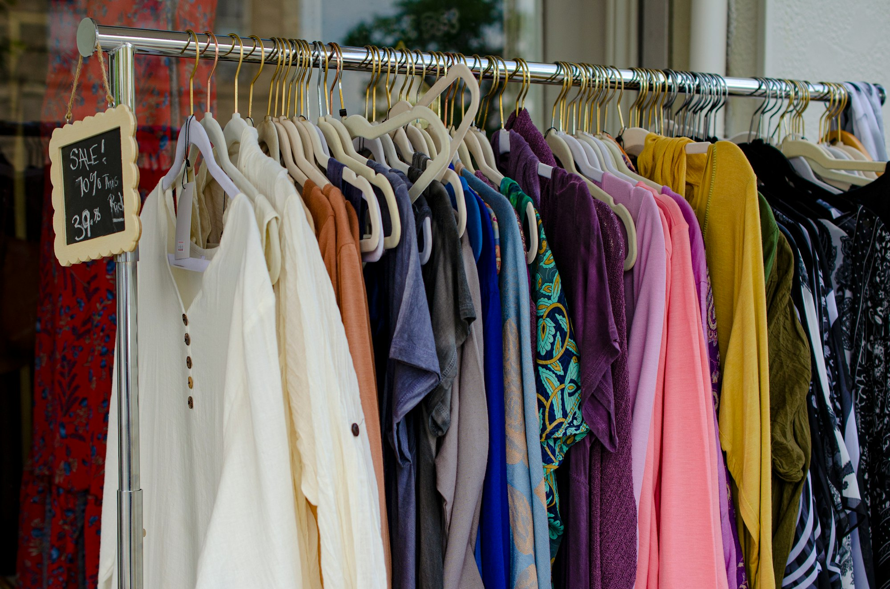

On the third floor of a department store, between the new-season coats and the escalator, there is a rack that sells out faster than anything around it. The tags are handwritten. The jackets are slightly worn at the cuffs. Every item on it has belonged to someone else, and the floor manager, a former stylist named Celine, restocks it twice a day.

Secondhand clothing used to live at the edges of retail: in charity shops, flea markets and the occasional vintage boutique. Today it is being given prime floor space, its own checkout lanes and, increasingly, its own line in quarterly earnings reports.

## A coat that sells twice

The business case is simple. A brand that sells a wool coat once earns money once. A brand that buys that coat back, cleans it and sells it again earns a second margin on something it has already designed, made and marketed.

Many retailers now run take-back programs that offer store credit for returned items. The clothes are graded, repaired when needed and either resold in stores, listed online or passed to recycling partners. Buyers get a familiar label at a lower price, and the brand keeps them inside its own shops.

_Resale racks now sit beside new collections in many stores. Photo: Megan Lee / Unsplash_

## Why shoppers are switching

For younger shoppers especially, secondhand has lost any stigma it once carried. Finding a well-made piece for less than a new fast-fashion version has become a point of pride, and resale apps have turned browsing into something closer to a hunt.

> "Nobody asks if it is used anymore. They ask if anyone else has the same one."
>
> — a shop assistant who has worked a resale floor for four years

Price is a big part of the appeal, but it is not the only one. Shoppers interviewed on resale floors cite a mix of reasons:

- Better quality for the same budget, especially in coats and denim
- Pieces that are no longer sold new
- A sense that buying used is a small, practical step to waste less

## The hard part is the back room

Running resale at scale is not as easy as hanging clothes on a rack. Every item is different, which means sorting, pricing and photographing one piece at a time. Retailers describe their warehouses as closer to a library than a stockroom.

Some are investing in grading tools and repair studios. Others partner with specialist resale companies that handle everything from collection to shipping. Margins can be thin until the volume is high enough, and not every experiment has lasted.

Still, the direction is clear. At the end of a Saturday shift, Celine counts what is left on her rack: two scarves and a pair of boots in an unusual size. Everything else has gone home with someone new, for the second or third time.
