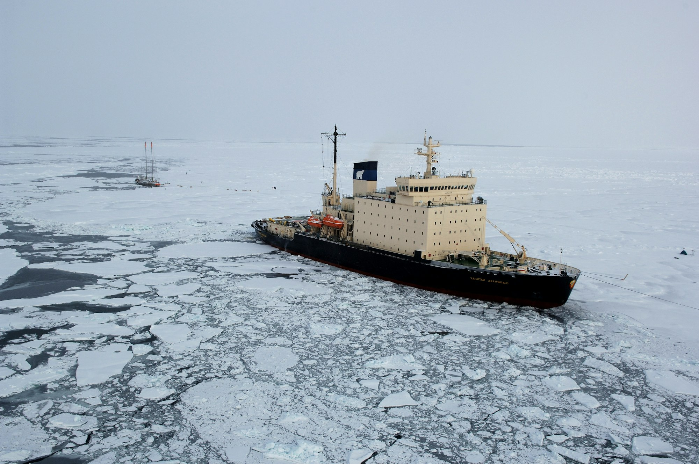

The bridge of an ice-class cargo ship is quieter than most people expect. There is the hum of the engines, the crackle of a radio, and every few minutes a long, grinding shudder as the bow rides up onto a floe and splits it in two. Outside, the horizon is a smear of white and pale blue, and the only landmark is the dark line of open water an escort vessel has cut ahead.

A decade ago, a passage like this was a stunt. Now it is a line item. As summer sea ice shrinks and thins, the waters along the top of the world stay navigable for longer each year, and shipping companies are doing the arithmetic. A voyage between northern Europe and East Asia over the pole can be thousands of miles shorter than the traditional route through southern canals, which means less fuel, fewer days at sea, and a hedge against chokepoints that keep making headlines.

## A season that keeps stretching

The appeal is simple, but the window is still narrow. Most commercial transits happen between late July and October, when the pack ice has loosened enough for strengthened hulls to push through with help. Each year that window seems to open a little earlier and close a little later, and insurers, port authorities, and ship designers have started planning around it.

That planning shows up in small, practical ways. Crews now train on ice simulators. Hulls are being ordered with thicker plating at the waterline. Small coastal towns that once saw a supply ship twice a summer are drafting plans for fuel depots and search-and-rescue stations, hoping to earn something from the traffic passing their shores.

_Pack ice can close around a ship within hours, even late in the season. Photo: NOAA / Unsplash_

## The ice does not read the forecast

The people who spend their working lives up here tend to be the least excited about the boom. Sea ice is thinner than it used to be, but thinner ice also moves faster and less predictably, and a channel that was open at breakfast can close by dinner.

> You can plan the route on a screen in an office, but out here the ice decides. Some days it lets you through, some days it just sits there and waits for you to make a mistake.

That was how one ice pilot, who has guided cargo ships through the northern passages for more than a decade, put it during a slow transit last summer. He keeps a paper notebook of every season's conditions, and he says the pages have become harder to compare from one year to the next.

There are other worries too. Rescue resources are thin across huge stretches of coastline. An oil spill in freezing water would be extraordinarily hard to clean up. And the region's wildlife, from migrating whales to seabird colonies, is already under pressure from the warming that is opening the routes in the first place.

## Who sets the rules

For now, the shortcut is governed by a patchwork. Coastal states set their own requirements for escorts and permits, an international code lays out safety standards for polar ships, and shipping lines decide for themselves how much risk they are willing to carry. Several large carriers have publicly said they will avoid the routes altogether, at least for now, citing environmental concerns.

Others are quietly testing them, one cautious voyage at a time. What happens over the next few seasons will depend less on any single decision than on a slow accumulation of experience: how many ships make it through cleanly, how many get stuck, and whether the ice keeps retreating as fast as the models suggest.
