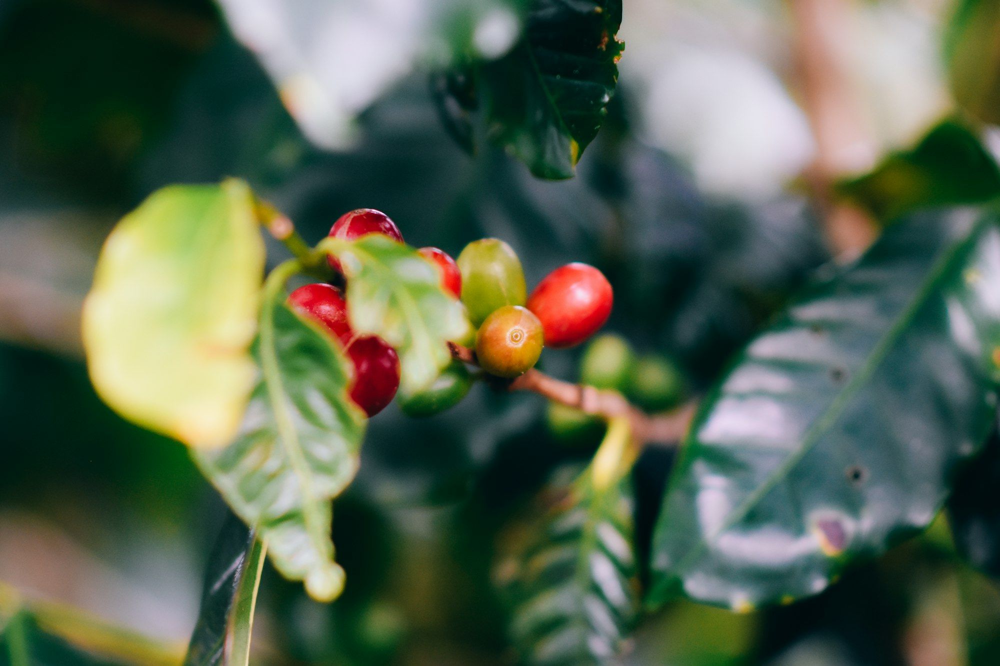

At a small roastery on the edge of an industrial park, the morning ritual starts with a spreadsheet. Before the first batch of beans hits the drum, the owner, Dana, checks what her importer is asking for the next container of washed arabica. For most of the past decade, that number barely moved. This year it has climbed so steeply that she now reprices her wholesale list every six weeks instead of once a year.

The pressure began with poor harvests and tangled shipping routes, and it has taken a long time to work its way down the supply chain. Roasters bought ahead, cafes held prices to keep their regulars, and supermarkets ran promotions to protect market share. That cushion is now gone, and the price of a bag of beans or a cup at the counter is starting to reflect what green coffee actually costs.

## Weather on the farm, sticker shock in town

Coffee is unusually exposed to the weather. Arabica grows best in a narrow band of altitude and temperature, and a dry spell at flowering time can trim a harvest months before anyone picks a cherry. Several major growing regions have had uneven seasons back to back, and farmers who once kept a buffer of stored beans have sold it down.

Robusta, the hardier variety used in instant coffee and many espresso blends, used to act as a release valve when arabica got expensive. That has stopped working as well, because robusta harvests have had troubles of their own. When both varieties tighten at once, buyers have nowhere cheap to turn.

_Ripening coffee cherries in Costa Rica. Photo: Chalo Garcia / Unsplash_

## How cafes are adjusting

Most coffee shops are not raising prices in one jump. The changes are smaller and harder to spot:

- A medium drink that quietly becomes the new large
- Oat and almond milk surcharges creeping up by a quarter
- Loyalty cards that now take twelve stamps instead of ten
- Single-origin pour-overs dropped in favor of a house blend

> People will forgive you for charging forty cents more. They won't forgive you if the coffee gets worse.

That is how a cafe manager who has run the same counter for eleven years puts it. Some owners are leaning into transparency, posting short notes by the register that explain where the money goes. Others are betting on volume, keeping a basic drip coffee cheap and nudging customers toward pastries and sandwiches, where margins are healthier.

## A slow drift, not a spike

Growers say better weather could ease prices within a season or two, but few in the trade expect a quick return to the old normal. Freight costs remain unpredictable, fertilizer is still expensive, and many farmers are replanting with young trees that will not yield fully for several years.

For drinkers, the practical effect is likely to be a slow drift rather than a sudden jump. A home brewer might notice that a favorite bag now costs a dollar or two more. A daily cafe customer might spend a few hundred dollars more over a year without ever seeing a single dramatic price change on the menu board.

Dana has made her peace with it. She has trimmed her lineup from nine coffees to six and spends more time talking with customers about what they are tasting. "If they're paying more," she said, "they should know why it's worth it."
