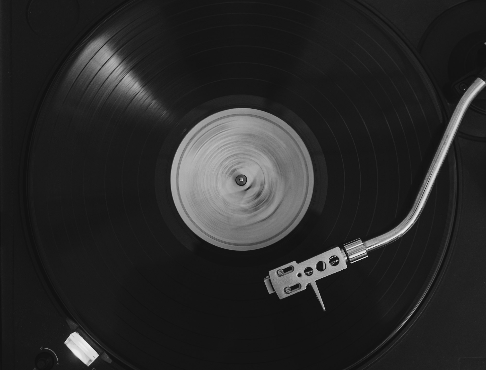

The press hisses every thirty seconds. A puck of black plastic, warmed until it is soft as dough, drops between two metal stampers, and the machine closes on it with several tons of force. When it opens again, a record is born: grooves, label, and a thin ring of excess vinyl that a blade trims away. An operator named Dariusz lifts it out, checks it under a lamp and stacks it on a spindle.

He has done this for twenty-six years. The machine he runs is older than he is.

## A boom built on old iron

Vinyl's comeback has outlasted every prediction that it was a fad. Record shops that closed a generation ago have reopened, supermarkets stock new releases next to the cereal, and a new album from a popular artist now routinely comes in three or four colored variants.

The trouble is that very few new pressing machines were built for decades. Most plants still rely on presses made in the 1970s and 1980s, kept running with salvaged parts and improvised fixes. A handful of companies now build modern presses, but they are expensive, and a plant that buys one still needs people who know how to tune it.

> "You can buy a new press in a year. Training someone to hear when it is about to go wrong takes five."
>
> — a pressing plant supervisor who started as an apprentice

_A finished record has to survive weeks of queues before it reaches a turntable. Photo: Andrea Cipriani / Unsplash_

## The wait for a release date

For independent musicians, the backlog has real costs. A band planning a spring tour may need to order records the previous autumn and hope the test pressings come back clean. A single rejected test can push a release back by weeks.

Smaller artists describe a familiar list of headaches:

- Lead times that stretch from a few weeks to several months
- Minimum orders that are hard to fill without a label behind them
- Colored and splatter variants that slow the line and raise the reject rate

Some have started releasing music digitally first and selling records later, turning the vinyl into a souvenir rather than a launch.

## New hands on the line

The quiet shift is happening inside the plants. Several have started apprenticeship programs, pairing veterans like Dariusz with younger operators who grew up buying records rather than making them. A trainee named Maya, who joined from a job in a bakery, says the work reminded her of bread: temperature, timing and a feel for when something is ready.

Plants are also experimenting with recycled vinyl compounds and with steam systems that use less energy, partly to cut costs and partly because buyers increasingly ask where their records come from.

None of it will clear the queue overnight. But on a Friday afternoon, as the last batch of the week cools on its spindle, Dariusz holds one up to the lamp and nods. The grooves are clean. Somewhere, someone has been waiting four months to drop the needle on it.
