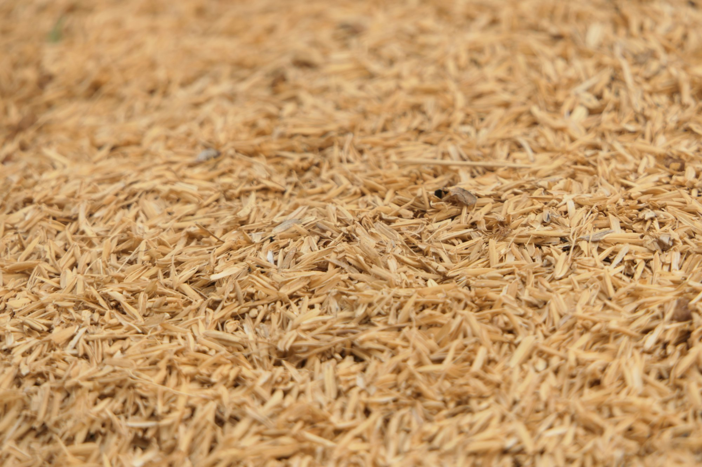

In a port warehouse stacked to the rafters with fifty-kilo sacks, a shipping clerk named Arjun keeps two calendars on his wall. One tracks vessel arrivals. The other tracks political announcements, because in his experience a single export notice from a major producer can strand a cargo or double its value overnight.

Rice is the daily staple for billions of people, yet only a small slice of the global harvest is ever traded across borders. Most countries grow and eat their own. That thin international market is exactly what makes it so sensitive. When a few large exporters restrict sales to protect their own consumers, import-dependent nations scramble, prices jump, and what began as a domestic decision becomes a diplomatic one.

## A thin market with a long reach

Wheat and corn are traded in vast volumes and backed by deep futures markets. Rice is different. It comes in dozens of varieties that are not easily swapped, and buyers in one region often turn down grains that are standard elsewhere. A country that relies on a particular long-grain or fragrant variety cannot simply switch suppliers when one door closes.

That makes exporters unusually influential. A temporary export duty, a minimum price floor, or a ban on certain grades can ripple through markets far from where the decision was made. Importing governments have learned to watch these signals closely, and some now treat food security as a standing item in trade talks, alongside energy and defense.

_Harvested paddy rice, still in its husk, before milling. Photo: Utsman Media / Unsplash_

## Deals struck between ministries

Diplomats describe a new kind of bargaining. Instead of buying on the open market, importers increasingly sign government-to-government supply agreements that guarantee a set tonnage over several years. In return, they may offer access for other goods, cooperation on fertilizer, or investment in irrigation and storage.

The tools on the table now include:

- Long-term supply contracts negotiated between governments rather than traders
- Strategic reserves large enough to ride out a season of high prices
- Joint investments in mills, silos, and port facilities
- Regional pacts that pledge members will not cut each other off during a shortage

> Everyone says rice is just food until the shelves are half empty. Then it is the only thing anyone in the capital wants to talk about.

That warning comes from a grain trader who has brokered shipments across Asia and Africa for two decades, and who now spends as much time reading policy briefings as price sheets.

## Farmers caught in the middle

Export limits are usually framed as protecting consumers at home, but they can leave farmers worse off. When governments cap what can be sold abroad, local prices may sag just as growers are paying more for diesel, seed, and fertilizer. Some farmer groups are lobbying for clearer rules, arguing that sudden policy swings make it impossible to plan a planting season.

Climate pressure adds another layer. Paddies depend on reliable water, and heat during flowering can cut yields sharply. As erratic monsoons and salt water creeping into coastal fields become more common, more countries are likely to feel exposed, and more of them will want guarantees.

For Arjun, the result is a job that looks less like logistics and more like reading the news. "I used to worry about the weather at sea," he said. "Now I worry about the weather in parliament."
