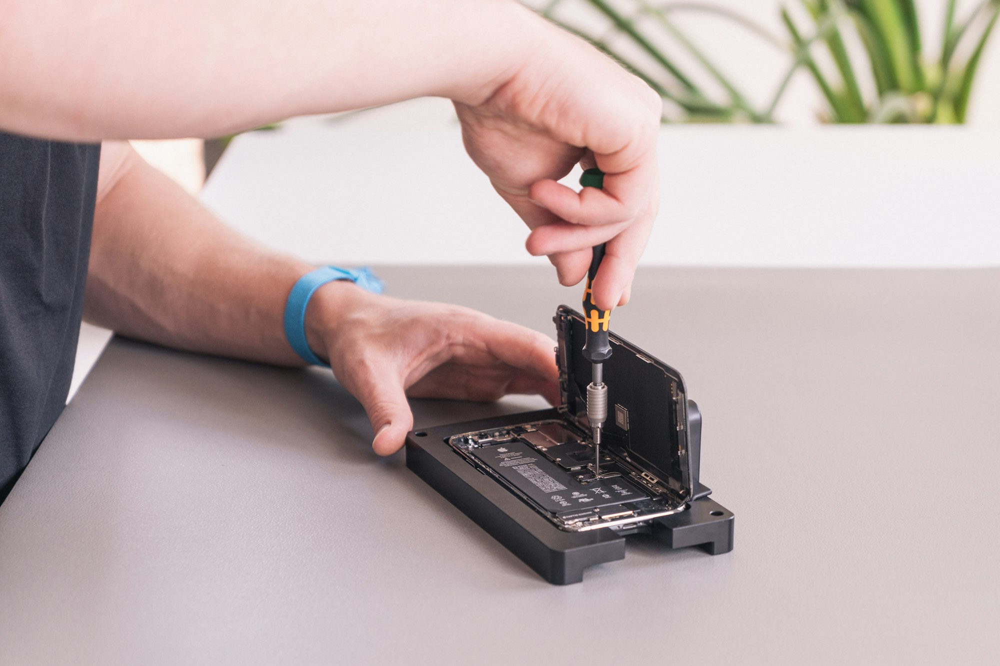

The repair counter sits at the back of a hardware store, between the paint mixer and a rack of garden hoses. On a weekday afternoon there are four phones waiting on the mat: two with cracked screens, one that will not hold a charge past lunch, and one that simply feels slow. The technician, a former bicycle mechanic named Tomas, expects to hand all four back before closing time.

A few years ago most of those phones would have gone into a drawer, replaced by something new on a monthly plan. Now a growing number of owners are asking a different question at the end of a contract: what would it take to keep this one going?

## The battery is the whole story

For most people, a phone does not die. Its battery does. After two or three years of daily charging, a pack that once lasted a full day starts giving up by mid-afternoon, and the phone gets blamed for being old.

Newer rules in several markets now push manufacturers to make batteries replaceable with common tools and to sell spare parts for years after a model launches. The effect is showing up at counters like Tomas's. A battery swap that once meant mailing the phone away for a week now takes about forty minutes and costs a fraction of a new device.

> "People come in ready to say goodbye to the phone. Most of the time it just needs a battery and a clean charging port."
>
> — a repair technician who has worked the counter for three years

_A screen and battery swap at a repair bench usually takes under an hour. Photo: Revendo / Unsplash_

## Software is catching up

Hardware is only half of it. A phone with a fresh battery still has to run the apps its owner needs, and that depends on how long its maker keeps sending updates. Support windows have stretched noticeably, with several manufacturers now promising security patches for five years or more on their mid-range models.

That changes the math for ordinary buyers. Keeping a phone for four or five years instead of two means:

- Fewer large payments, or a smaller monthly plan once the device is paid off
- Less time spent moving photos, passwords and settings to a new handset
- One less device sitting unused in a kitchen drawer

## What the upgrade cycle loses

None of this means people have stopped wanting new phones. Camera improvements and bigger screens still sell, and plenty of buyers enjoy the ritual of unboxing something shiny every couple of years.

But the default is shifting. Retailers report more trade-ins being refurbished and resold rather than shredded, and repair shops say their busiest season now runs straight through the launch months that used to empty their counters.

Back at the hardware store, a nurse named Ines collects her phone, now on its third battery and its fifth year. She turns it on, checks the charge and slips it into her pocket. "I was about to spend a month's rent on a new one," she says. "This cost me less than a dinner out."
